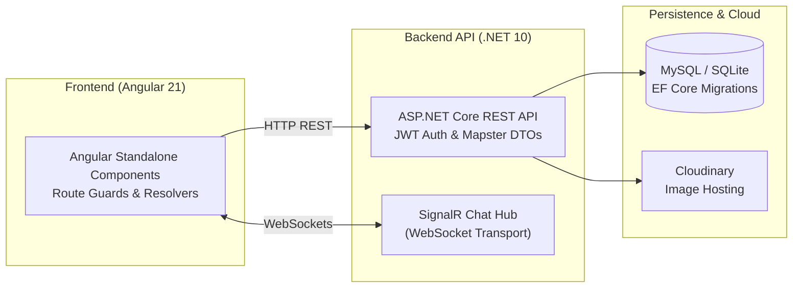

<div align="center">

# 💬 Adda

### Full-stack social networking platform featuring real-time SignalR chat, photo moderation, and RBAC

[](https://github.com/akazad13/adda/actions)
[](https://angular.dev/)
[](https://dotnet.microsoft.com/)
[](https://dotnet.microsoft.com/)
[](https://dotnet.microsoft.com/)
[](https://www.mysql.com/)
[](LICENSE)

[Overview](#-overview) •
[Architecture](#-architecture) •
[Tech Stack](#-tech-stack) •
[Repository Layout](#-repository-layout) •
[Quick Start](#-quick-start) •
[Testing](#-testing) •
[License](#-license)

</div>

---

## 📌 Overview

**Adda** is a modern full-stack social networking and messaging platform featuring instant direct chat over WebSockets (SignalR), a filterable member directory, profile customization, Cloudinary photo moderation workflows, and fine-grained role-based access control (Admin, Moderator, Member).

🔗 **Live Deployment**: [https://addaa.alwaysdata.net](https://addaa.alwaysdata.net)  
*(Demo Moderator: Username `John`, Password `Password`)*

### Key Highlights
- 💬 **Real-Time Direct Messaging**: Bi-directional instant chat powered by ASP.NET Core SignalR WebSockets with message history and unread status.
- 👤 **Profiles & Member Directory**: Age calculation, bios, interest tags, bookmarking, and multi-photo galleries.
- 📸 **Cloudinary Media Moderation**: Multi-photo upload with an approval pipeline for public gallery moderation.
- 🛡️ **Role-Based Access Control**: JWT Bearer authentication with ASP.NET Core Identity roles (`Admin`, `Moderator`, `Member`).
- 🎨 **Dark Glassmorphic UI**: High-contrast modern interface with custom design tokens, toast notifications (`ngx-toastr`), and Google Fonts (*Outfit*, *Plus Jakarta Sans*).

---

## 🏛 Architecture



> [!NOTE]
> Angular Route Resolvers pre-fetch profile data before rendering views, ensuring instant zero-flicker transitions.

---

## 🛠 Tech Stack

| Domain | Technologies |
| :--- | :--- |
| **Frontend Framework** | Angular 21 (Standalone Components, Signals, Resolvers) |
| **Frontend UI & Styling** | Custom Dark Glassmorphism, Bootstrap 5, FontAwesome 6, `ngx-bootstrap`, `ngx-toastr` |
| **Real-time WebSockets** | `@microsoft/signalr` |
| **Backend Framework** | ASP.NET Core 10 Web API, C# 13 |
| **Persistence & ORM** | Entity Framework Core 10 (MySQL & SQLite support) |
| **Authentication** | JWT Bearer Authentication with ASP.NET Core Identity RBAC |
| **Object Mapping** | Mapster (High-performance compiled mapper) |
| **Media Storage** | Cloudinary API |
| **Testing** | xUnit (Backend), Karma & Jasmine (Frontend) |

---

## 📂 Repository Layout

```text
├── backend/
│   ├── Adda.API/                 # ASP.NET Core 10 Web API
│   │   ├── Controllers/          # REST endpoints (Auth, Users, Messages, Admin)
│   │   ├── Data/                 # DataContext, migrations, and seed data
│   │   ├── Dtos/                 # Data Transfer Objects
│   │   ├── Helpers/              # Mapster configs and pagination helpers
│   │   ├── Hubs/                 # SignalR ChatHub
│   │   ├── Models/               # Entities (User, Photo, Message, Role)
│   │   ├── Repositories/         # Repository implementations
│   │   └── Services/             # Token service and business logic
│   └── Adda.API.Tests/           # xUnit integration and unit tests
└── frontend/                     # Angular 21 Single Page Application
    ├── src/
    │   ├── app/
    │   │   ├── admin/            # Role and photo moderation views
    │   │   ├── guards/           # Route authorization guards
    │   │   ├── members/          # Member directory, card, detail & edit
    │   │   ├── messages/         # Direct messaging & threads
    │   │   └── services/         # API, Notification, Auth & Chat services
    │   └── styles.css            # Dark glassmorphic design tokens
```

---

## 🚀 Quick Start

### Prerequisites
- [.NET 10 SDK](https://dotnet.microsoft.com/)
- [Node.js 20+](https://nodejs.org/) & npm 9+
- MySQL Server (or SQLite fallback)

### 1. Setup Backend
```bash
cd backend/Adda.API

# Apply database migrations
dotnet ef database update

# Run the API server
dotnet run
```
API starts at `https://localhost:44392` (or configured port).

### 2. Setup Frontend
```bash
cd frontend

# Install dependencies
npm install --legacy-peer-deps

# Start Angular dev server
npm start
```
Navigate to `http://localhost:4200/`.

---

## 🧪 Testing

| Test Suite | Framework | Command |
| :--- | :--- | :--- |
| **Backend Tests** | xUnit | `cd backend && dotnet test` |
| **Frontend Tests** | Karma & Jasmine | `cd frontend && npx ng test --watch=false` |

---

## 👤 Author

**Md. Abul Kalam**
- GitHub: [@akazad13](https://github.com/akazad13)
- LinkedIn: [Md. Abul Kalam](https://linkedin.com/in/akazad13)

---

## 📄 License

This project is licensed under the [MIT License](LICENSE).
